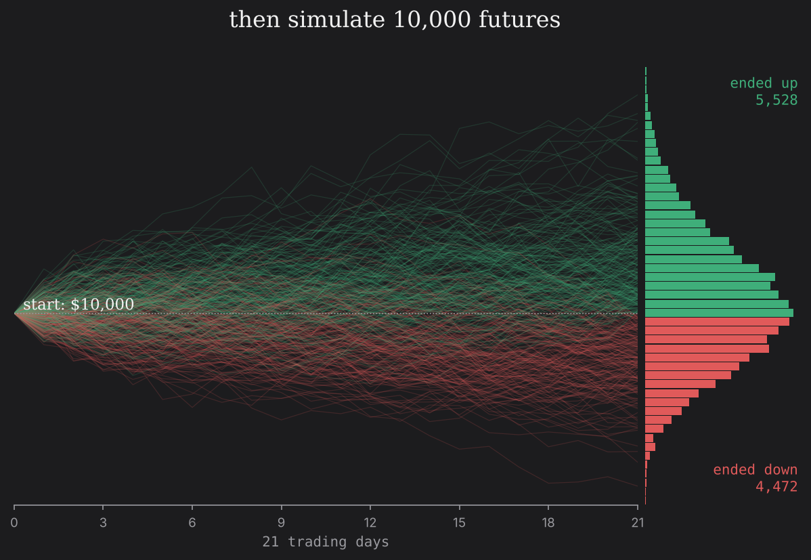
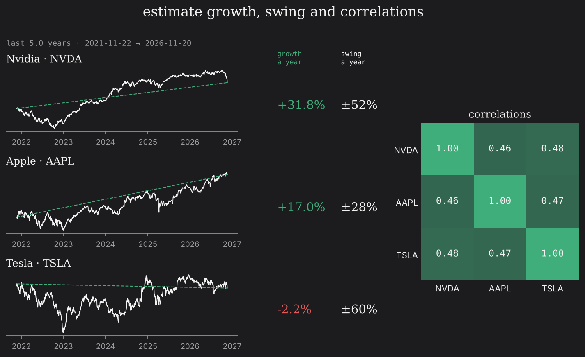
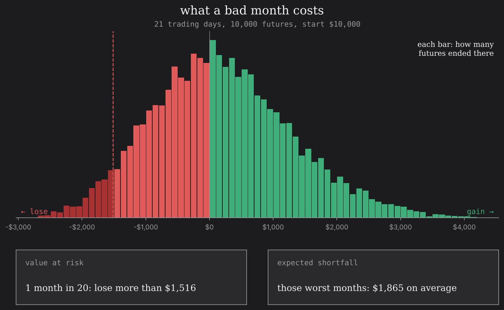
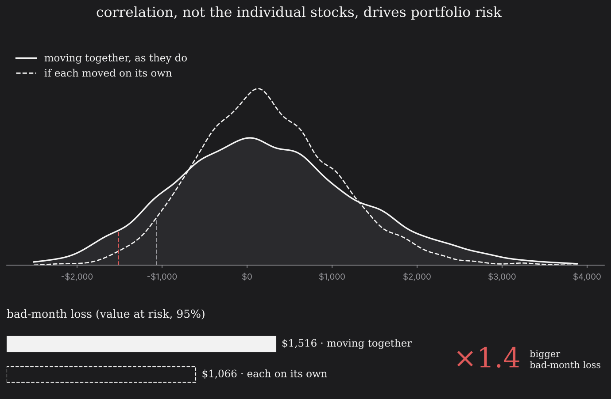

# Monte Carlo Portfolio Risk

Estimate each stock's growth, swing and correlations from five years of prices, simulate
10,000 one-month futures for a $10,000 portfolio, and read the risk off the outcomes:

- **Value at risk (95%)**: one month in 20, you lose more than this.
- **Expected shortfall**: in those worst months, you lose this much on average.
- **What correlation adds**: the same portfolio if each stock moved on its own.

The lesson: **correlation, not the individual stocks, drives portfolio risk.**



## Results: real prices, 22 Nov 2021 → 20 Nov 2026

Equal-weighted Nvidia, Apple and Tesla, $10,000, 21 trading days, 10,000 futures,
daily adjusted closes from Yahoo Finance:

| | Growth a year | Swing a year |
|---|---|---|
| NVDA | +31.8% | ±52% |
| AAPL | +17.0% | ±28% |
| TSLA | −2.2% | ±60% |

Correlations between the three stocks: 0.46 to 0.48.

| | Moving together | Each on its own |
|---|---|---|
| Value at risk (95%) | **$1,516** | $1,066 |
| Expected shortfall | **$1,865** | $1,351 |

Moving together makes the bad-month loss **×1.4** bigger. Full output:
[`docs/img/real/report.txt`](docs/img/real/report.txt).

Note: the window ends on a −15% day for NVDA (TSLA −8% and AAPL −2% the same day), which
pulls NVDA's 5-year growth estimate down.



| | |
|---|---|
|  |  |

## Check against the video (demo inputs)

`--demo` uses the growth and swing figures shown in the original explainer video
(NVDA +40% ±52%, AAPL +20% ±28%, TSLA +2.5% ±59% a year), which come from an earlier
5-year window. The video does not show the correlations, so the demo **assumes 0.40 for
every pair**. With that single assumption the model lands within 1% of the video's figures:

| | Demo | Video |
|---|---|---|
| Value at risk (95%) | $1,423 | $1,435 |
| Expected shortfall | $1,762 | $1,776 |
| Each on its own | $1,030 | $1,021 |
| Correlation effect | ×1.4 | ×1.4 |

Charts: [`docs/img/demo/`](docs/img/demo/).

## Run it

```bash
pip install -r requirements.txt

python -m mcrisk --demo                         # video inputs, no download
python -m mcrisk                                # NVDA AAPL TSLA, last 5 years from Yahoo Finance
python -m mcrisk --tickers KO PEP SPY --years 3 --weights 0.4 0.4 0.2
python -m mcrisk --csv my_prices.csv            # date column, then one column per ticker
```

Options: `--capital 10000`, `--days 21`, `--sims 10000`, `--confidence 0.95`, `--seed 42`,
`--out output/`, `--no-plots`. Each run prints a report and writes `summary.json` plus four
charts to the output folder.

Tests: `pip install pytest && python -m pytest`

### Interactive page

`web/index.html` is a self-contained page (in French) that runs the same simulation in the
browser: pick stocks and amounts among 14 tickers, change the horizon or the tail, and watch
10,000 futures being drawn. Open it in any browser; it needs no server. Its data (daily mean
and covariance of log returns, weekly price lines) is frozen on 20 Nov 2026; refresh it with
`PYTHONPATH=. python web/build_data.py --end YYYY-MM-DD`.

## Method

1. **Estimate** (`mcrisk/estimate.py`). Daily log returns from adjusted closes. Growth a year
   = `exp(252 × mean daily log return) − 1`; swing a year = `daily volatility × √252`;
   correlations from the same daily returns.
2. **Simulate** (`mcrisk/simulate.py`). Each day, each stock gets a log return
   `μ + L·z`, where `z` is independent standard normals and `L·Lᵀ` is the covariance
   (Cholesky). 10,000 futures × 21 days, buy-and-hold, no rebalancing.
3. **Compare** (`simulate_pair`). The "each on its own" run keeps every stock's growth and
   swing but sets correlations to zero, and reuses the **same random draws**, so the gap
   between the two runs is the correlation effect and not simulation noise.
4. **Measure** (`mcrisk/risk.py`). VaR = minus the 5% quantile of profit and loss;
   expected shortfall = minus the average of the outcomes at or below that quantile.

## Limits

- Daily returns are modelled as normal and independent from day to day: no fat tails,
  volatility clustering or regime changes, so tail risk is likely understated.
- Growth, swing and correlations are assumed constant over the month and equal to their
  5-year averages. Correlations tend to rise in sell-offs, which this model does not capture.
- Past prices do not predict future returns; the drift estimate is especially noisy.

## Layout

```
mcrisk/
  data.py       Yahoo Finance download, CSV loader, demo inputs
  estimate.py   MarketParams: growth, swing, correlations
  simulate.py   correlated Monte Carlo, same-draws comparison
  risk.py       value at risk, expected shortfall, summary
  plots.py      the four charts
  cli.py        command line (python -m mcrisk)
tests/          32 tests, including a check against the video's figures
docs/img/real/  charts and report from real prices (22 Nov 2021 → 20 Nov 2026)
docs/img/demo/  charts from the demo run
```
